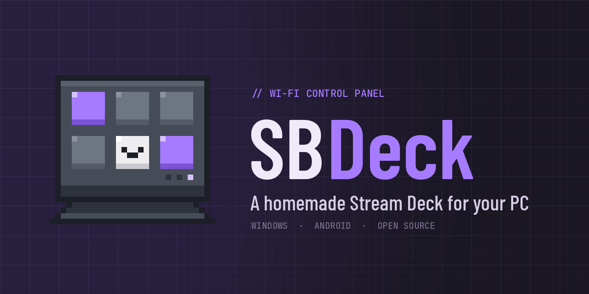

<p align="center">
  
</p>

<p align="center">
  <a href="README.md">Español</a> · <b>English</b>
</p>

<p align="center">
  <a href="LICENSE"></a>
  
  
  
</p>

**SBDeck** turns any old Android tablet or phone into a button panel for your computer. The tablet only shows a web page; a lightweight program in the Windows tray sends it live data and runs whatever you tap. Everything stays on your local network, with no cables and no internet needed.

It is built to be **light**: it runs on a tablet with 1 GB of RAM, with no extra animations and nothing to install on the tablet except a browser.

<div align="center">

### Support the project

SBDeck is free and open source. If it helps you, you can support its development:

**Bank alias (Argentina): `uarodriguez.wb`** &nbsp;&middot;&nbsp; Holder: Ulises Agustin Rodriguez

<sub>Any contribution, big or small, is appreciated. A GitHub star or a bug report helps too.</sub>

</div>

---

## Modes

| Mode | What it shows or does |
|---|---|
| **Monitor** | FPS, 1% low and frametime (MSI Afterburner), CPU and GPU temperature and load, VRAM, RAM, network and ping |
| **Audio** | Per‑app volume and mute with real app icons, level meters, microphone and system output spectrum |
| **Deck** | Paged buttons: open apps and links, keyboard shortcuts, sounds, commands, microphone, monitors and media |
| **Music** | What is playing in Windows (YouTube Music, Spotify, etc.) with cover art, progress bar and controls |
| **Tasks** | A to‑do list stored on the PC |
| **Clock** | Time, timer and screen dimming for the night |

Buttons are edited from the tablet or from the PC's browser, and they fetch the **real logo** of the app or website automatically.

## Requirements

- **Windows 10 or 11**. If Python is missing, SBDeck installs Python 3.12 by itself.
- **MSI Afterburner** with RivaTuner Statistics Server, for FPS and temperatures.
- An **Android** tablet or phone with **Fully Kiosk Browser**, on the same Wi‑Fi network.

## Install on the PC

**With Git** (recommended, so it updates itself):

```powershell
git clone https://github.com/UlisesSB/SBDeck.git
```

**Without Git**: *Code → Download ZIP* and extract it anywhere. It will not update itself; to update, download the ZIP again and copy over your `data/` folder.

Then **double‑click `SBDeck.bat`**. The first run takes a few minutes while it sets up Python, the libraries and MultiMonitorTool. It stays in the system tray and starts with Windows from then on.

Then:

1. **Afterburner**: under *Settings → Monitoring* enable *Framerate*, *Framerate 1% low*, *Frametime*, *GPU temperature*, *GPU usage*, *Memory usage*, *CPU temperature* and *CPU clock*. Set it to start with Windows.
2. **Firewall**: Windows asks the first time. Allow **Private networks**.
3. **Router**: reserve the PC's IP (*DHCP reservation*) so the address never changes.

## The tablet

In **Fully Kiosk Browser**:

- *Start URL*: the address shown by the SBDeck tray icon, for example `http://192.168.0.10:8765`.
- To see only the deck: turn off **Show Action Bar**, **Show Status Bar** and **Show Navigation Bar**, and turn on **Fullscreen Mode**.
- Also enable: keep screen on, locked landscape orientation and start on boot.

## Usage

| Action | Result |
|---|---|
| Double‑click the tray icon | Opens the deck in edit mode in the PC's browser |
| Tab on the left edge of the tablet | Shows the modes |
| *Deck → Editar* | Add, edit, move or delete buttons and pages |
| *Elegir programa de la PC* | Lists your installed apps and fetches their real logo |
| Tray icon → *Buscar actualizaciones* | Pulls the latest version from GitHub |
| *Ajustes → Estado de la PC* (tablet) | Shows what still needs setting up |

**Monitor buttons**: `solo-principal` keeps only the Windows primary monitor on; `solo:2` keeps only `\\.\DISPLAY2`. Make it a toggle: tapping it again turns the others back on.

**Sounds**: copy the `.mp3` or `.wav` into `sonidos/` and type the file name in the button.

**Tasks from your scripts**: `POST /api/tareas` with `{"t": "text"}`.

## Updates

SBDeck runs `git pull` every time it starts, and from the tray icon → *Buscar actualizaciones*. If the page changed, the tablet reloads itself; if the program changed, it restarts itself. Your data in `data/` is never touched.

## Troubleshooting

- On the tablet, **Ajustes → Estado de la PC** shows what is missing.
- Quit SBDeck from the tray and run `SBDeck-consola.bat` to see its messages, or check `data/sbdeck.log`.

## License

Released under the **MIT** license: you may use, modify and share it freely, as long as you keep the copyright notice crediting the author. See [LICENSE](LICENSE).

The SBDeck logo and banners are part of the project's identity; if you fork it under another name, please use your own.

**Third party**

- [Barlow Condensed](https://fonts.google.com/specimen/Barlow+Condensed), [IBM Plex Sans](https://fonts.google.com/specimen/IBM+Plex+Sans) and [JetBrains Mono](https://fonts.google.com/specimen/JetBrains+Mono) fonts, under the SIL Open Font License 1.1, loaded from Google Fonts.
- [MultiMonitorTool](https://www.nirsoft.net/utils/multi_monitor_tool.html) by NirSoft (freeware). Not bundled: `SBDeck.bat` downloads it from the official site.
- Python libraries: aiohttp, psutil, NumPy, pycaw, comtypes, PyAudioWPatch, keyboard, Pillow, pystray, icoextract, pywin32 and PyWinRT, each under its own license.
- MSI Afterburner, RivaTuner, Discord and other names are trademarks of their owners. SBDeck only reads the data those programs share.

## Author

**Ulises Agustin Rodriguez**

- Portfolio: [uarodriguez.com](https://uarodriguez.com)
- GitHub: [@UlisesSB](https://github.com/UlisesSB)
- Contact: [uarodriguez@computer.org](mailto:uarodriguez@computer.org)

<sub>Copyright © 2026 Ulises Agustin Rodriguez.</sub>
