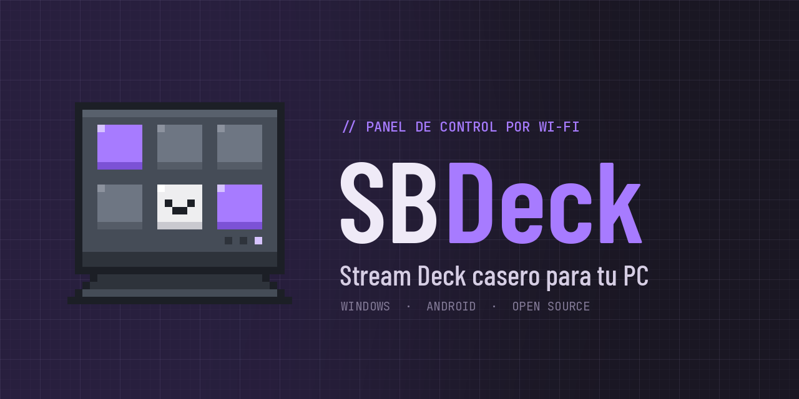
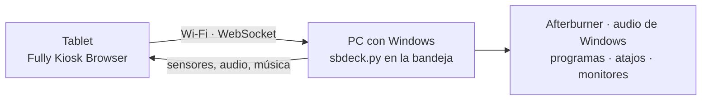

<p align="center">
  
</p>

<p align="center">
  <b>Español</b> · <a href="README.en.md">English</a>
</p>

<p align="center">
  <a href="LICENSE"></a>
  
  
  
</p>

**SBDeck** convierte cualquier tablet o celular Android viejo en un panel de botones para tu computadora. La tablet solo muestra una página web; un programa liviano que vive en la bandeja de Windows le manda los datos en vivo y ejecuta lo que tocás. Todo viaja por tu red local, sin cables y sin internet.

La idea es que sea **liviano**: anda en una tablet de 1 GB de RAM, sin animaciones de más y sin nada que instalar en la tablet salvo un navegador.

<div align="center">

### Apoya el proyecto

SBDeck es gratuito y de código abierto. Si te sirve, puedes ayudarme a seguir mejorándolo:

**Alias bancario (Argentina): `uarodriguez.wb`** &nbsp;&middot;&nbsp; Titular: Ulises Agustin Rodriguez

<sub>Cualquier aporte, grande o chico, se agradece. Una estrella en GitHub o reportar un error ayuda igual.</sub>

</div>

---

## Modos

| Modo | Qué muestra o hace |
|---|---|
| **Monitor** | FPS, 1% bajo y frametime (MSI Afterburner), temperatura y uso de CPU y GPU, VRAM, RAM, red y ping |
| **Audio** | Volumen y silencio por aplicación con su ícono real, vúmetros, espectro del micrófono y de lo que suena en la PC |
| **Deck** | Botones con páginas: abrir programas y enlaces, atajos de teclado, sonidos, comandos, micrófono, monitores y multimedia |
| **Música** | Lo que suena en Windows (YouTube Music, Spotify, etc.) con portada, barra de progreso y controles |
| **Tareas** | Lista de tareas que se guarda en la PC |
| **Reloj** | Hora, temporizador y atenuar pantalla para la noche |

Los botones se editan desde la tablet o desde el navegador de la PC, y traen solos el **logo real** del programa o del sitio web.

## Cómo funciona



1. La PC sirve la página en `http://IP-DE-TU-PC:8765`.
2. La tablet la abre y queda conectada por WebSocket.
3. La PC le manda los datos en vivo; la tablet le manda los toques.
4. Tus botones, tareas y configuración se guardan en la PC, en `data/`.

## Requisitos

- **Windows 10 u 11**. Si no tenés Python, SBDeck instala Python 3.12 solo.
- **MSI Afterburner** con RivaTuner Statistics Server, para FPS y temperaturas.
- Una tablet o celular **Android** con **Fully Kiosk Browser**, en la misma red Wi‑Fi.

## Instalación en la PC

**Con Git** (recomendado, así se actualiza solo):

```powershell
git clone https://github.com/UlisesSB/SBDeck.git
```

**Sin Git**: *Code → Download ZIP* y descomprimilo donde quieras. Así no se actualiza solo; para actualizar, bajá el ZIP de nuevo y copiá tu carpeta `data/`.

Después hacé **doble clic en `SBDeck.bat`**. La primera vez tarda unos minutos porque prepara todo: Python, las librerías y MultiMonitorTool. Queda en la bandeja del sistema y se abre solo cada vez que prendés la PC; no hace falta volver a abrirlo.

Después:

1. **Afterburner**: en *Configuración → Supervisión* activá *Framerate*, *Framerate 1% low*, *Frametime*, *GPU temperature*, *GPU usage*, *Memory usage*, *CPU temperature* y *CPU clock*. Dejalo abriéndose con Windows.
2. **Firewall**: la primera vez Windows pregunta. Permití **Redes privadas**.
3. **Router**: reservá la IP de la PC (*Reserva DHCP*) para que la dirección no cambie.

## La tablet

En **Fully Kiosk Browser**:

- *Start URL*: la dirección que muestra el ícono de SBDeck en la bandeja, por ejemplo `http://192.168.0.10:8765`.
- Para ver solo el deck: apagá **Show Action Bar**, **Show Status Bar** y **Show Navigation Bar**, y activá **Fullscreen Mode**. Las barras de Android aparecen solo si deslizás desde el borde.
- Activá también: mantener la pantalla encendida, orientación horizontal fija y abrir al encender la tablet.

## Uso

| Acción | Resultado |
|---|---|
| Doble clic en el ícono de la bandeja | Abre el deck en modo edición en el navegador de la PC |
| Pestaña de la izquierda en la tablet | Muestra los modos |
| *Deck → Editar* | Agrega, edita, mueve o borra botones y páginas |
| *Elegir programa de la PC* | Lista tus programas y trae su logo real |
| Clic derecho en el ícono → *Buscar actualizaciones* | Baja la última versión desde GitHub |
| *Ajustes → Estado de la PC* (en la tablet) | Muestra qué parte falta configurar |

**Botones de monitores**: `solo-principal` deja encendido solo el monitor principal de Windows, el de la barra de tareas; `solo:2` deja solo `\\.\DISPLAY2`. Marcalo como interruptor: al volver a tocarlo se encienden los demás.

**Sonidos**: copiá el `.mp3` o `.wav` a `sonidos/` y en el botón escribí el nombre del archivo.

**Discord**: en *Ajustes → Atajos de teclado* poné *Silenciar (alternar)* en `Ctrl+Shift+M` para el botón "Mute Discord".

**Tareas desde tus scripts**: `POST /api/tareas` con `{"t": "texto"}`.

## Actualizaciones

SBDeck hace `git pull` cada vez que arranca, y también desde el ícono → *Buscar actualizaciones*. Si cambió la página, la tablet se recarga sola; si cambió el programa, se reinicia solo. Tus datos en `data/` no se tocan.

## Si algo no anda

- En la tablet, **Ajustes → Estado de la PC** muestra qué parte falta.
- Cerrá SBDeck desde la bandeja y abrí `SBDeck-consola.bat` para ver los mensajes, o mirá `data/sbdeck.log`.

<details>
<summary>¿Por qué la página no está en GitHub Pages?</summary>

GitHub Pages sirve por `https`, y los navegadores no dejan que una página `https` se conecte a un servidor `ws://` sin certificado dentro de tu casa. Por eso la página la sirve la misma PC. El retardo es el mismo, porque los toques viajan solo por tu Wi‑Fi.

</details>

## Estructura del repositorio

```
SBDeck/
├── sbdeck.py               Programa de la PC: servidor, sensores, audio, música, acciones y bandeja
├── web/                    Página de la tablet (index.html y logos)
├── sonidos/                Sonidos de los botones
├── assets/                 Logo, banners e ícono
├── SBDeck.bat              Instala todo la primera vez y abre SBDeck
├── SBDeck-consola.bat      Abre SBDeck mostrando los mensajes
├── requirements.txt
├── CHANGELOG.md
└── LICENSE
```

Al usarlo se crean `data/` (tus botones, tareas y configuración), `tools/` y `.venv/`, que no se suben al repositorio.

## Licencia

Distribuido bajo la licencia **MIT**: podés usarlo, modificarlo y compartirlo libremente, siempre que mantengas el aviso de copyright con el crédito al autor. Ver [LICENSE](LICENSE).

El logo y los banners de SBDeck son parte de la identidad del proyecto; si hacés un fork con otro nombre, usá los tuyos.

**De terceros**

- Fuentes [Barlow Condensed](https://fonts.google.com/specimen/Barlow+Condensed), [IBM Plex Sans](https://fonts.google.com/specimen/IBM+Plex+Sans) y [JetBrains Mono](https://fonts.google.com/specimen/JetBrains+Mono), bajo la SIL Open Font License 1.1, cargadas desde Google Fonts y usadas también en los banners.
- [MultiMonitorTool](https://www.nirsoft.net/utils/multi_monitor_tool.html) de NirSoft (freeware). No se incluye en el repositorio: `SBDeck.bat` lo baja de su sitio oficial.
- Librerías de Python: aiohttp, psutil, NumPy, pycaw, comtypes, PyAudioWPatch, keyboard, Pillow, pystray, icoextract, pywin32 y PyWinRT, cada una bajo su propia licencia.
- MSI Afterburner, RivaTuner, Discord y demás nombres son marcas de sus dueños. SBDeck solo lee los datos que esos programas comparten.

## Autor

**Ulises Agustin Rodriguez**

- Portafolio: [uarodriguez.com](https://uarodriguez.com)
- GitHub: [@UlisesSB](https://github.com/UlisesSB)
- Contacto: [uarodriguez@computer.org](mailto:uarodriguez@computer.org)

<sub>Copyright © 2026 Ulises Agustin Rodriguez.</sub>
